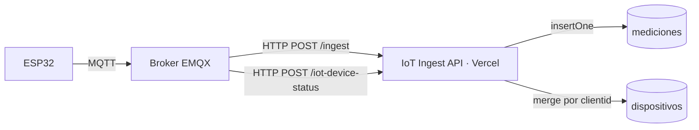

# IoT Ingest API

API HTTP que recibe los datos de los dispositivos IoT (ESP32) a través del broker **EMQX** y los guarda en **MongoDB Atlas**.

- **Stack:** Node.js · Express 5 · TypeScript · MongoDB driver
- **Hosting:** Vercel (función serverless de Node.js)
- **Producción:** https://iot-ingest.vercel.app

> ⚠️ **Estado: PoC / desarrollo.** Los endpoints **no tienen autenticación** todavía. Ver [Seguridad y pendientes](#seguridad-y-pendientes).

---

## Índice

- [Cómo funciona](#cómo-funciona)
- [Endpoints](#endpoints)
  - [POST /ingest](#post-ingest)
  - [POST /iot-device-status](#post-iot-device-status)
  - [GET /, /health, /debug](#get--health-debug)
  - [Errores](#errores)
- [Modelo de datos](#modelo-de-datos)
- [Estructura del proyecto](#estructura-del-proyecto)
- [Variables de entorno](#variables-de-entorno)
- [Desarrollo local](#desarrollo-local)
- [Deploy en Vercel](#deploy-en-vercel)
- [Configuración de EMQX](#configuración-de-emqx)
- [Pruebas](#pruebas)
- [Troubleshooting](#troubleshooting)
- [Seguridad y pendientes](#seguridad-y-pendientes)

---

## Cómo funciona



1. El ESP32 publica por MQTT en el broker EMQX.
2. Una **regla** de EMQX reenvía el mensaje por HTTP a esta API.
3. La API guarda el body **tal cual llega** en MongoDB (base `iot_sensores`), sin esquema fijo:
   - **`mediciones`**: un documento nuevo por cada mensaje (histórico).
   - **`dispositivos`**: **un documento por dispositivo**; cada mensaje nuevo se mezcla con lo que ya había.

---

## Endpoints

Base URL: `https://iot-ingest.vercel.app`

| Método | Ruta | Descripción |
|---|---|---|
| `POST` | `/ingest` | Guarda el body tal cual en `mediciones` (un documento por mensaje) |
| `POST` | `/iot-device-status` | Guarda el body tal cual en el documento del dispositivo en `dispositivos` |
| `GET` | `/` | Info básica del servicio |
| `GET` | `/health` | Verifica la conexión con MongoDB |
| `GET` | `/debug` | Base de datos en uso y cantidad de documentos por colección |

**Tolerancia de entrada** (aplica a todas las rutas):

- Se acepta **cualquier `Content-Type`** (o ninguno): el body se lee como texto y se parsea como JSON si se puede. Si no es JSON, se trata como `{ "payload": "<texto>" }`.
- Las rutas también responden con prefijo **`/api`** y con **barra final**: `/api/ingest/` = `/ingest`.
- Tamaño máximo del body: **1 MB** (más grande → `413`).

### POST /ingest

Guarda el body **tal cual llega** como un documento nuevo en `mediciones`. No hay esquema fijo: cualquier objeto JSON es válido y se guarda sin transformar (objetos anidados, arrays, claves con puntos, valores que empiezan con `$`, etc.). Solo se agrega `_receivedAt`.

**Request** (cualquier objeto JSON, por ejemplo)

```json
{
  "schema_version": "2.2",
  "clientid": "N1N4",
  "message_type": "telemetry",
  "readings": { "soil_moisture": 41.2, "temp_c": 19.8 }
}
```

**Documento guardado**

```js
{
  _id: ObjectId("..."),
  schema_version: "2.2",
  clientid: "N1N4",
  message_type: "telemetry",
  readings: { soil_moisture: 41.2, temp_c: 19.8 },
  _receivedAt: ISODate("2026-11-07T01:00:00Z")
}
```

**Respuestas**

| Código | Body |
|---|---|
| `201` | `{ "ok": true, "id": "6aee75a01919c01ab5f51187" }` |
| `400` | `{ "ok": false, "error": "body is empty", "received": {} }` |
| `400` | `{ "ok": false, "error": "body must be a JSON object", "received": [ ... ] }` |

> Si EMQX manda su sobre por defecto (`${*}`), el mensaje del dispositivo llega dentro de `payload` **como string** y así se guarda. Para guardar directamente el JSON del dispositivo, configurar el body de la acción en EMQX como `${payload}`. Ver [Configuración de EMQX](#configuración-de-emqx).

**Ejemplo**

```bash
curl -X POST https://iot-ingest.vercel.app/ingest -H 'Content-Type: application/json' -d '{"clientid":"sensor-01","readings":{"temp_c":22.5,"hum":60}}'
```

### POST /iot-device-status

Guarda el body **tal cual llega** en el documento del dispositivo dentro de `dispositivos`. Hay **un documento por dispositivo**, identificado por `clientid`:

- Si el dispositivo no existe, se crea con el body.
- Si existe, el body se **mezcla** con lo que ya había: los campos que vienen en el mensaje **reemplazan** a los anteriores (completos, aunque sean objetos), y los que no vienen **se conservan**.
- Se agregan `_createdAt` (primera vez visto, no cambia) y `_lastSeen` (último mensaje).

No se calcula ni se renombra nada: si el mensaje trae `connectivity.status`, se guarda ese campo y nada más.

**Identificación del dispositivo.** Se usa el primer valor que exista (string o número, se guarda como texto):

1. `clientid`, `clientId`, `client_id`, `deviceId`, `device_id`, `id` del body
2. Los mismos campos dentro de `payload` (objeto o string JSON)
3. Query string: `?clientid=...`

El documento siempre tiene un campo `clientid` con ese valor, que es la clave (índice único). Si el id vino en otro campo, por ejemplo `device_id`, ese campo también queda guardado tal cual.

**Ejemplo de mezcla**

```js
// 1er mensaje (estado del ESP32)
{ "clientid": "N1N4", "project_id": "UADE-A26T02", "connectivity": { "status": "connected", "type": "wifi" } }

// 2do mensaje (evento de EMQX)
{ "clientid": "N1N4", "event": "client.disconnected", "reason": "keepalive_timeout" }

// Documento resultante en dispositivos
{
  _id: ObjectId("..."),
  clientid: "N1N4",
  project_id: "UADE-A26T02",
  connectivity: { status: "connected", type: "wifi" },
  event: "client.disconnected",
  reason: "keepalive_timeout",
  _createdAt: ISODate("..."),
  _lastSeen: ISODate("...")
}
```

**Respuestas**

| Código | Body |
|---|---|
| `200` | `{ "ok": true, "clientid": "N1N4", "created": false }` (`created: true` si el dispositivo es nuevo) |
| `400` | `{ "ok": false, "error": "clientid is required", "received": { ... } }` |
| `400` | `{ "ok": false, "error": "body must be a JSON object", "received": [ ... ] }` |

**Ejemplo**

```bash
curl -X POST https://iot-ingest.vercel.app/iot-device-status -H 'Content-Type: application/json' -d '{"clientid":"sensor-01","connectivity":{"status":"connected"},"device_status":{"state":"operational"}}'
```

### GET /, /health, /debug

```bash
curl https://iot-ingest.vercel.app/health
# {"ok":true,"mongo":"up"}

curl https://iot-ingest.vercel.app/debug
# {"ok":true,"database":"iot_sensores","counts":{"dispositivos":1,"mediciones":1}}
```

`/debug` no expone credenciales, solo nombres de colecciones y cantidades.

### Errores

Todas las respuestas de error son JSON con la misma forma:

```json
{ "ok": false, "error": "mensaje", "received": "<body recibido, solo en 400>" }
```

| Código | Cuándo |
|---|---|
| `400` | Body inválido (vacío en `/ingest`, sin `clientid` o no-objeto en `/iot-device-status`) |
| `404` | Ruta o método inexistente, ej. `{"ok":false,"error":"No route for GET /iot-device-status"}` |
| `413` | Body mayor a 1 MB |
| `500` | Error interno (ej. MongoDB caído o `MONGODB_URI` sin configurar) |

---

## Modelo de datos

Base de datos: **`iot_sensores`** (configurable con `MONGODB_DB`).

**Sin esquema fijo:** los documentos guardan exactamente lo que mandan los dispositivos. Los únicos campos que agrega el servidor empiezan con `_`, para distinguirlos de los datos del dispositivo.

### Colección `mediciones`

Un documento por mensaje recibido en `/ingest`. Es histórico: nunca se actualiza.

| Campo | Origen | Descripción |
|---|---|---|
| `_id` | Mongo | Generado por Mongo (si el body trae `_id`, se ignora) |
| *(todo lo demás)* | Dispositivo | El body tal cual llegó |
| `_receivedAt` | Servidor | Fecha de recepción |

### Colección `dispositivos`

Un documento por dispositivo, con **índice único** en `clientid` (lo crea la API automáticamente).

| Campo | Origen | Descripción |
|---|---|---|
| `_id` | Mongo | Generado por Mongo (si el body trae `_id`, se ignora) |
| `clientid` | Servidor | Identificador del dispositivo (ver [cómo se resuelve](#post-iot-device-status)) |
| *(todo lo demás)* | Dispositivo | La mezcla de todos los bodies recibidos; el último valor de cada campo gana |
| `_createdAt` | Servidor | Primera vez que se vio el dispositivo |
| `_lastSeen` | Servidor | Último mensaje recibido |


---

## Estructura del proyecto

```
.
├── api/
│   └── index.ts               # Entry point de Vercel: exporta la app de Express
├── src/
│   ├── app.ts                 # Arma Express: middlewares → rutas → 404 → errores
│   ├── server.ts              # Arranque local (app.listen)
│   ├── routes.ts              # Registra los controllers
│   ├── config/
│   │   └── env.ts             # Variables de entorno centralizadas
│   ├── database/
│   │   └── mongo.ts           # Cliente de MongoDB cacheado (reutilizado entre requests)
│   ├── common/
│   │   ├── http-error.ts      # HttpError / BadRequestError
│   │   └── utils.ts           # Helpers de tipos y parseo de JSON
│   ├── middlewares/
│   │   ├── body-parser.ts     # Lee cualquier body y lo parsea como JSON si puede
│   │   ├── request-logger.ts  # Loguea método, ruta, content-type y body
│   │   ├── api-prefix.ts      # Permite /api/* como alias
│   │   └── error-handler.ts   # 404 y manejo central de errores
│   └── modules/
│       ├── measurements/      # POST /ingest → mediciones
│       ├── devices/           # POST /iot-device-status → dispositivos
│       └── system/            # GET /, /health, /debug
├── vercel.json                # Redirige todas las rutas a /api
├── tsconfig.json
└── .env.example
```

### Capas

Cada módulo de dominio (`measurements`, `devices`) tiene los mismos cuatro archivos:

| Archivo | Responsabilidad |
|---|---|
| `*.dto.ts` | Tipos de entrada, del documento guardado y de la respuesta. La función `toXxxDto(body)` **valida** el body (que sea un objeto, que tenga `clientid`) y lanza `BadRequestError` si es inválido |
| `*.controller.ts` | Solo HTTP: lee el request, arma el DTO, llama al service y responde |
| `*.service.ts` | Lógica de negocio (qué metadatos agregar, quitar `_id` del body) |
| `*.repository.ts` | Único punto de acceso a MongoDB |

```
Request → middlewares → Controller → DTO (validación) → Service → Repository → MongoDB
                                ↘ si algo lanza un error → error-handler → respuesta JSON
```

Los controllers no tienen `try/catch`: Express 5 propaga los errores de las funciones `async` al `error-handler` central.

**Para agregar un endpoint nuevo:** crear `src/modules/<nombre>/` con los cuatro archivos y registrar el controller en `src/routes.ts`.

---

## Variables de entorno

| Variable | Obligatoria | Default | Descripción |
|---|---|---|---|
| `MONGODB_URI` | **sí** | — | Cadena de conexión de MongoDB Atlas |
| `MONGODB_DB` | no | `iot_sensores` | Base de datos |
| `MONGODB_COLLECTION` | no | `mediciones` | Colección para `/ingest` |
| `MONGODB_DEVICES_COLLECTION` | no | `dispositivos` | Colección para `/iot-device-status` |
| `PORT` | no | `3000` | Puerto local (Vercel lo ignora) |

En local van en un archivo `.env` (copiar de `.env.example`; está en `.gitignore`). En Vercel se configuran con `vercel env add` o desde el dashboard.

---

## Desarrollo local

Requisitos: Node.js 22+.

```bash
npm install
cp .env.example .env        # y completar MONGODB_URI
npm run dev
```

La API queda en `http://localhost:3000`. Los scripts cargan `.env` automáticamente si existe.

> Ojo: con la misma `MONGODB_URI`, en local se escribe en la **misma base que producción**. Para separarlas, definir otro `MONGODB_DB` en el `.env` (ej. `iot_sensores_dev`).

| Script | Qué hace |
|---|---|
| `npm run dev` | Levanta el servidor con `tsx watch` (recarga al guardar) |
| `npm start` | Levanta el servidor sin watch |
| `npm run typecheck` | Corre `tsc --noEmit` |

> No hay script `build` a propósito: Vercel compila `api/index.ts` por su cuenta, y si existiera `build` lo ejecutaría durante el deploy.

---

## Deploy en Vercel

El proyecto está vinculado a Vercel (`.vercel/`) como **`iot-ingest`**.

```bash
# Primera vez: vincular y cargar la variable de entorno
npx vercel link
npx vercel env add MONGODB_URI production

# Deploy a producción
npx vercel --prod
```

Cómo lo sirve Vercel: `api/index.ts` exporta la app de Express como función serverless, y `vercel.json` reescribe todas las rutas (`/(.*)`) hacia `/api`. El cliente de Mongo se cachea a nivel de módulo, así que se reutiliza mientras la instancia siga viva.

**Requisitos en otros servicios:**

- **MongoDB Atlas → Network Access:** permitir `0.0.0.0/0`, porque Vercel no tiene IPs fijas.
- **Vercel → Settings → Deployment Protection:** la URL de producción (`iot-ingest.vercel.app`) tiene que ser pública para que EMQX pueda llamarla. Las URLs de cada deploy (`iot-ingest-xxxx-...vercel.app`) piden login de Vercel y responden `401`: **no usarlas en EMQX**.

**Logs:**

```bash
npx vercel logs --since 30m             # logs de la función (cada request loguea su body)
npx vercel logs requests --since 30m    # requests con su código HTTP
```

---

## Configuración de EMQX

Crear en EMQX un **HTTP Server connector** (o Webhook) y una **regla** por endpoint.

**Connector / acción**

| Campo | Valor |
|---|---|
| URL | `https://iot-ingest.vercel.app/ingest` o `https://iot-ingest.vercel.app/iot-device-status` |
| Método | `POST` |
| Headers | `Content-Type: application/json` (recomendado, aunque la API no lo exige) |
| Body | `${payload}` → guarda el JSON que publicó el dispositivo, tal cual (**recomendado**)<br>`${*}` o vacío → guarda el sobre completo de EMQX (`topic`, `clientid`, `payload` como string, etc.) |

**Reglas sugeridas**

Telemetría → `/ingest`:

```sql
SELECT * FROM "agro/#"
```

Estado del dispositivo → `/iot-device-status`:

```sql
-- Mensajes de estado que publica el ESP32
SELECT * FROM "agro/+/status"

-- Y/o eventos de conexión del broker
SELECT * FROM "$events/client_connected", "$events/client_disconnected"
```

> Ajustar los topics a los que realmente publica el firmware.

---

## Pruebas

La API se probó de punta a punta contra producción con un script que manda requests reales y después **compara en MongoDB que el documento guardado sea idéntico al body enviado**. Al terminar borra todos los datos de prueba (prefijo `qa-`). 31 de 31 casos pasan:

- **`/ingest`:** bodies con objetos anidados, arrays, `null`, booleanos, decimales, unicode, claves con puntos y valores con `$` se guardan idénticos; el `_id` del body se ignora y no hay choques; funciona sin `Content-Type`, con `text/plain` y con `/api/`; un texto no JSON se guarda como `{ payload: "<texto>" }`; body vacío, `{}` o array → `400`.
- **`/iot-device-status`:** el primer mensaje crea el documento igual al body; el segundo agrega campos nuevos, reemplaza los que trae y conserva los demás; `_createdAt` se mantiene y `_lastSeen` avanza; el id se toma de `clientid`, `clientId`, `device_id`, de dentro de `payload` o de `?clientid=`; sin id o con array → `400`.
- **Carga:** 10 mensajes simultáneos del mismo dispositivo → todos `200`, 1 solo documento.

Pruebas rápidas a mano: ver los `curl` en [Endpoints](#endpoints).

---

## Troubleshooting

| Síntoma | Causa probable | Solución |
|---|---|---|
| `/health` → `MONGODB_URI is not set` | Falta la variable en Vercel | `npx vercel env add MONGODB_URI production` y redeploy |
| `/health` tarda y falla | Atlas bloquea la IP de Vercel | Atlas → Network Access → `0.0.0.0/0` |
| EMQX recibe `401` | Usa la URL de un deploy específico, o Deployment Protection está activa | Usar `https://iot-ingest.vercel.app` y revisar Deployment Protection |
| EMQX recibe `404` | Ruta mal escrita, método `GET`, o apunta a `/` | La respuesta dice qué ruta y método llegaron; corregir la URL de la regla |
| EMQX recibe `400 clientid is required` | El body no trae `clientid` | El campo `received` de la respuesta muestra qué llegó; revisar el body de la acción en EMQX |
| `curl` responde `400` con `received: {}` | Se rompieron las comillas al pegar el comando | Pegar el `curl` en una sola línea |
| No veo los datos en Atlas | Estás mirando otra base | `/debug` muestra la base en uso (`iot_sensores`) |
| En Vercel el request figura con "Status 0" | Es como lo muestra la vista de detalle | Revisar el código real con `npx vercel logs requests` |

---

## Seguridad y pendientes

Estado actual: **sin autenticación**. Cualquiera que conozca la URL puede escribir en la base.

Pendientes:

- [ ] **API key:** middleware que valide un header `x-api-key` (desde variable de entorno o colección en Mongo), configurado como header fijo en la acción HTTP de EMQX.
- [ ] Proteger o eliminar `/debug`.
- [ ] Mover el script de pruebas e2e al repo (`npm run test:e2e`).
- [ ] Repo git propio en esta carpeta y deploy automático desde GitHub.
